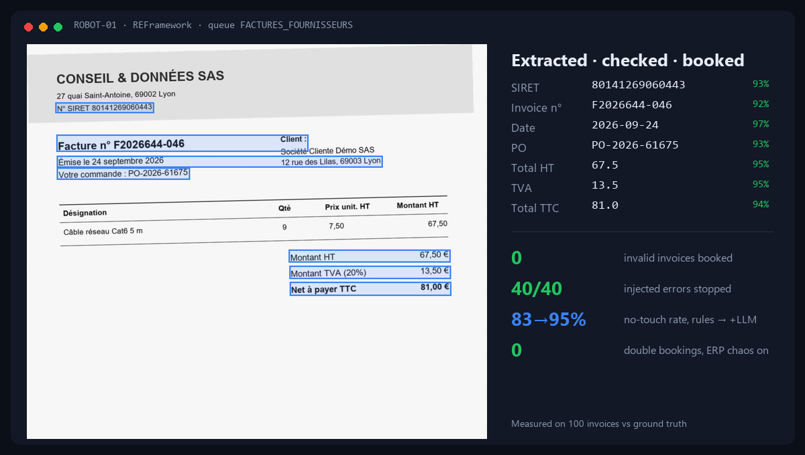
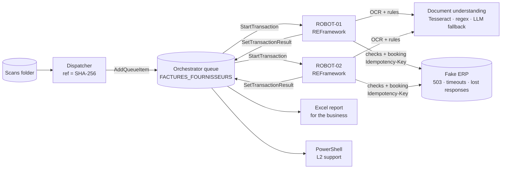
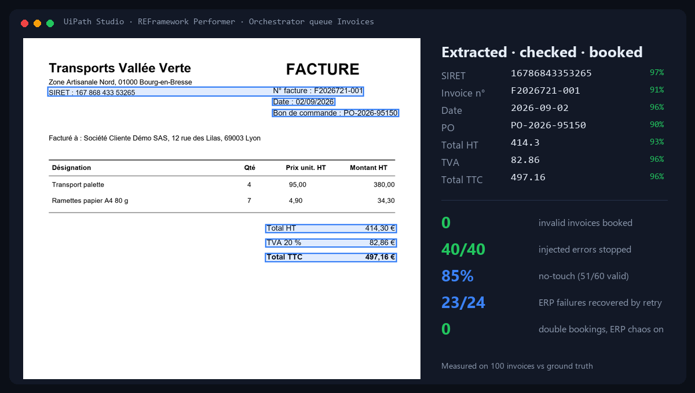

# rpa-document-automation-lab

An **invoice-processing robot** built on UiPath's architecture. The pieces are the same ones a UiPath
project uses:
- an Orchestrator-style work queue (unique reference, auto-retry, abandoned items);
- a Dispatcher and a REFramework Performer, with two unattended robots running in parallel;
- the split between business and system exceptions;
- OCR document understanding with a human-review route and an optional local-LLM fallback;
- a target ERP that fails on purpose;
- PowerShell tooling for level-2 support.

All of it runs on a laptop with free tools. **Every figure below comes from a measured run against ground
truth.** The documents and their expected outcomes are generated before the robot sees them.

The process exists twice: first in Python (runs anywhere), then as **real UiPath robots** — a Dispatcher and a
REFramework Performer built in UiPath Studio 26.10 and run against a UiPath Orchestrator queue. Both process
the same 100 invoices under the same ERP failures; see [The UiPath version](#the-uipath-version).



> 🇫🇷 Documentation projet en français : [PDD](docs/PDD.md) (définition du processus, règles de gestion,
> faisabilité) · [SDD](docs/SDD.md) (conception) · [Runbook support N2](docs/runbook-support-n2.md).

## Why this project

RPA roles (UiPath / Power Platform) ask for these skills: queue design, exception handling, recette
(acceptance testing), deployment documentation, level-2 support of robots in production, and increasingly
document AI. This lab practises each of them on one realistic process: supplier invoices arrive as scans,
get checked against the ERP, and are booked.

The design rule is the one that matters in accounts payable: **an invalid invoice must never be booked**.
Sending a valid one to a person costs a few minutes. Paying a wrong one costs money. The results therefore
report *wrongly booked* separately from everything else.

| What the job asks for | Where it is |
|---|---|
| UiPath Studio, REFramework, Orchestrator | [`uipath/`](uipath): Dispatcher + REFramework Performer (VB.NET), real Orchestrator queue with unique reference and auto-retry — [measured](#the-uipath-version) |
| Orchestrator queue contract, exception handling | [`orchestrator.py`](rpa_lab/orchestrator.py) reproduces the queue contract (OData endpoint names, unique reference, auto-retry on *Application* exceptions only, *Abandoned*) — 7 tests |
| REFramework, new robots | [`performer.py`](rpa_lab/performer.py): Init → Get Transaction → Process → Set Status → End, restart on system exception, stop after N consecutive |
| Maintain / make robots reliable | Idempotent booking survives lost ERP responses; chaos injection proves it ([SDD §4](docs/SDD.md#4-idempotence--le-point-délicat)) |
| Recette and fixing anomalies | `run_lab.py` scores every run against ground truth; the confusion matrix shows which rule fired for which document |
| Production, documentation, monitoring | PDD, SDD, runbook in French; JSON logs per robot with transaction fields; Excel exception report for the business |
| Level-2 support | [`Get-QueueHealth.ps1`](ops/Get-QueueHealth.ps1) (exit codes for monitoring), [`Invoke-RetryFailedItems.ps1`](ops/Invoke-RetryFailedItems.ps1) (`-WhatIf`, refuses while the ERP is down) |
| Feasibility study | Feasibility grid in the [PDD](docs/PDD.md#6-étude-de-faisabilité-grille-utilisée) |
| REST APIs, PowerShell, Python, SQL | FastAPI services, httpx client, SQLite with transactional `StartTransaction` |
| OCR, document automation, AI | Tesseract with per-word confidence, rule extraction, local LLM fallback that is never trusted without the same checks |
| Power Automate, SharePoint | **Not in this repo** — see the [component mapping](docs/uipath-power-automate-mapping.md) |

## Architecture



## The test set

`synthetic/generate.py` produces 100 fictional French supplier invoices (seeded, reproducible):
- **4 layouts.** Layouts A, B and C were used to write the extraction rules. Layout **D** was not: it
  uses different wording everywhere and stands for a new supplier whose invoices arrive one morning.
- **3 qualities.** Clean digital, office scan (skew, blur, grain, JPEG), and a degraded scan.
- **40 injected violations**, 8 of each: totals that do not add up, unknown supplier (SIRET), invoice
  already booked, purchase order not found, amount different from the PO.
- **4 re-sent files**: byte-identical copies of earlier scans.

The ERP fails on purpose. 6 % of requests get a 503, 3 % hang past the robot's timeout, and 8 % of
bookings **commit and then lose their response**, the case that causes double payments.

## Results

<!-- results:start -->
Measured on 100 generated invoices (40 with an injected business-rule violation), 2 robots in parallel, ERP chaos on (`{"RPA_ERP_FAILURE_RATE": "0.06", "RPA_ERP_SLOW_RATE": "0.03", "RPA_ERP_LOST_RESPONSE": "0.08"}`). Same documents, same chaos seed for both runs; robot scheduling makes the exact chaos hits differ slightly between runs.

| | Rules only | Rules + local LLM fallback |
|---|---|---|
| Valid invoices booked with no human touch (straight-through) | 50/60 (83.3 %) | 57/60 (95.0 %) |
| Invalid invoices **wrongly booked** | 0 | 0 |
| Invalid invoices stopped before booking | 40/40 | 40/40 |
| …stopped with the exact reason | 27 | 34 |
| Final outcome = expected outcome | 77.0 % | 91.0 % |
| Field accuracy, unseen supplier layout (D) | 44.2 % | 100.0 % |
| Field accuracy, known layouts A / B / C | 100.0 % / 97.8 % / 98.5 % | 100.0 % / 98.2 % / 99.0 % |
| System exceptions (ERP 503 / timeout / lost response) | 32 | 38 |
| …documents recovered by Orchestrator auto-retry | 22/24 | 25/28 |
| …lost ERP responses resolved without re-booking | 7 | 3 |
| Double bookings in the ERP | 0 | 0 |
| Re-sent scans rejected by the queue's unique reference | 4/4 | 4/4 |
| Mean time per transaction | 0.997 s | 1.921 s |

**L2 recovery (Rules only).** After the run, `Get-QueueHealth.ps1` exited `1` (2 item(s) still failed after automatic retries). The ERP was restarted without chaos, `Invoke-RetryFailedItems.ps1` re-queued 2 item(s), one robot re-ran, and the health check exited `0`. Straight-through went from 50 to 52/60, with 0 double booking(s) and 0 invalid invoice(s) booked.

**L2 recovery (Rules + LLM).** After the run, `Get-QueueHealth.ps1` exited `1` (3 item(s) still failed after automatic retries). The ERP was restarted without chaos, `Invoke-RetryFailedItems.ps1` re-queued 3 item(s), one robot re-ran, and the health check exited `0`. Straight-through went from 57 to 60/60, with 0 double booking(s) and 0 invalid invoice(s) booked.

Full numbers, the confusion matrix and the per-document trace: [`reports/baseline.json`](reports/baseline.json), [`reports/ai_fallback.json`](reports/ai_fallback.json).
<!-- results:end -->

### Reading the numbers honestly

- **0 wrongly booked** is the result the design is built around. It holds with the LLM switched on: the
  model only fills fields the rules could not read, and its values go through the same arithmetic, SIRET
  checksum, supplier, duplicate and PO checks.
- **Some injected errors are stopped with the "wrong" reason.** A *totals mismatch* where one amount is
  read with low OCR confidence goes to `BE_EXTRACTION_REVIEW`, because the robot cannot tell a supplier
  error from a misread. Either way the invoice is stopped and a person looks at it. That trade-off is
  deliberate ([PDD RG-03](docs/PDD.md#4-règles-de-gestion)).
- **The unseen layout is where the rules break**, as rules do in production. The LLM fallback closes most
  of that gap, at the cost of a slower average transaction (it only runs on documents the rules miss).
- The documents are synthetic. Real scans are messier, so treat the accuracy figures as a property of this
  test set, not a promise.

## The UiPath version

The same process, built in **UiPath Studio 26.10** (VB.NET) and run on a local robot connected to **UiPath
Orchestrator** (Automation Cloud):



- [`uipath/Solution/InvoiceDispatcher`](uipath/Solution/InvoiceDispatcher/Main.xaml) — scans the inbox,
  computes the SHA-256 of each file and calls *Add Queue Item* on the `Invoices` queue with the hash as
  *Reference*. The queue enforces unique references, so a re-sent scan is refused by Orchestrator
  (`409`, error 1016) and counted; any other error stops the run.
- [`uipath/InvoicePerformer`](uipath/InvoicePerformer) — the official **REFramework** template.
  [`Process.xaml`](uipath/InvoicePerformer/Framework/Process.xaml) reads the invoice, applies the rules
  RG-01 to RG-07 and throws a `BusinessRuleException` with the same codes as the Python robot
  (`BE_EXTRACTION_REVIEW`, `BE_TOTAL_MISMATCH`, `BE_UNKNOWN_SUPPLIER`, `BE_DUPLICATE_INVOICE`,
  `BE_PO_NOT_FOUND`, `BE_PO_AMOUNT_MISMATCH`). ERP calls use *HTTP Request* with no built-in retry, so a 503
  or timeout becomes a system exception and the **queue's auto-retry** re-runs the item; the booking carries
  an `Idempotency-Key`, so a retry after a lost response finds the booking instead of making a second one.
- OCR is **not** UiPath Document Understanding: the robot calls the lab's Tesseract reader through
  [`rpa_lab/extract_api.py`](rpa_lab/extract_api.py). The business rules all live in the UiPath workflow.

**Dispatcher, measured:** first run `Added: 100 | Duplicates rejected: 4` (the 4 re-sent scans), second run
on the same folder `Added: 0 | Duplicates rejected: 104`.

**Performer, measured** — 100 queue items, 1 robot, same ERP chaos as above, 173 s
([`reports/uipath_performer.json`](reports/uipath_performer.json), scored from the robot's execution log by
[`scripts/score_uipath_run.py`](scripts/score_uipath_run.py) with the definitions of `evaluate.py`):

| | Python, rules only | **UiPath REFramework** |
|---|---|---|
| Invalid invoices **wrongly booked** | 0 | **0** |
| Invalid invoices stopped before booking | 40/40 | **40/40** |
| …stopped with the exact reason | 27 | **27** |
| Valid invoices booked straight-through | 50/60 (83.3 %) | **51/60 (85.0 %)** |
| Final outcome = expected outcome | 77.0 % | **78.0 %** |
| Documents hit by system exceptions, recovered by auto-retry | 22/24 | **23/24** |
| Lost ERP responses resolved without re-booking | 7 | **7** |
| Double bookings in the ERP | 0 | **0** |

The one unrecovered document (`facture_065.png`) failed on all three attempts; on the last one the booking
committed and its response was lost. Orchestrator therefore shows it *Failed* while the ERP holds it, booked
once. One more retry closes it through the idempotency key — the L2 path above.

To reproduce: start the ERP (with the chaos variables) and `uvicorn --factory rpa_lab.extract_api:create_app
--port 8092`, run the Dispatcher then the Performer (Studio, or `uipcli package pack` +
`UiRobot execute --file <nupkg> --folder Shared`), then
`python scripts/score_uipath_run.py <Execution.log> <jobId>`.

## Run it

Requirements: Python 3.11+, [Tesseract 5](https://github.com/UB-Mannheim/tesseract/wiki) with the French
model, and optionally [Ollama](https://ollama.com) with `qwen2.5:7b` for the AI fallback. The L2 step uses
Windows PowerShell or `pwsh`.

```powershell
python -m venv .venv; .venv\Scripts\activate
pip install -r requirements.txt
# French OCR model, kept inside the project (git-ignored):
mkdir .tessdata; curl -L -o .tessdata/fra.traineddata https://github.com/tesseract-ocr/tessdata_best/raw/main/fra.traineddata

python synthetic/generate.py                                              # 100 invoices + ground truth
python scripts/run_lab.py --name baseline --robots 2 --chaos --l2-recovery
python scripts/run_lab.py --name ai_fallback --robots 2 --chaos --ai-fallback --l2-recovery
python scripts/render_results.py                                          # refresh the table above
pytest -q                                                                 # 21 tests
```

Each run writes `reports/<name>.json` and the business report `data/out/rapport_exceptions_<date>.xlsx`.
While services are up, the APIs are documented at `http://127.0.0.1:8090/docs` (Orchestrator) and
`:8091/docs` (ERP).

## Layout

```
rpa_lab/
  orchestrator.py       queue API (Orchestrator contract)
  dispatcher.py         inbox -> queue items
  performer.py          REFramework robot
  document.py           OCR + extraction + per-value confidence
  ai_fallback.py        local LLM reader (Ollama), output re-validated
  erp.py                fake ERP with chaos and idempotency
  evaluate.py           scoring against ground truth
  exceptions_report.py  Excel report for the business
  extract_api.py        OCR behind HTTP, called by the UiPath Performer
uipath/
  Solution/InvoiceDispatcher   UiPath Dispatcher (Studio 26.10, VB.NET)
  InvoicePerformer             UiPath REFramework Performer
ops/                    PowerShell L2 support scripts
docs/                   PDD, SDD, runbook (FR), UiPath / Power Automate mapping
synthetic/generate.py   test-set generator
reports/                measured results (committed)
```

All suppliers, SIRET numbers, purchase orders and amounts are invented.
